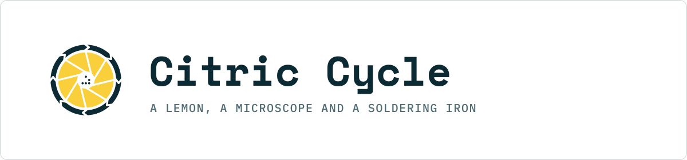

  <picture>
    <source media="(prefers-color-scheme: dark)" srcset="headers/readme-header-dark.svg">
    
  </picture>

# Citric Cycle — brand assets

The mark, avatars, favicons, README headers, the brand guide and the plot styles used across every [Citric Cycle](https://youtube.com/@citriccycle) episode. Episode repositories link here instead of carrying their own copies.

The mark: eight iris blades, a closed ring with eight clockwise notches, five seeds in the centre arranged as a Game of Life glider. Master unit is a 220 × 220 viewBox; ring outer edge r = 97, blades r = 76, centre r = 24, seeds r = 3.

## What is where

| Folder | Contents |
|---|---|
| `mark/svg/` | One-colour vector masters (plain SVG 1.1). The gaps are real holes, so the ground shows through. `cc-mark-lemon.svg` is the primary for dark grounds, `cc-mark-petrol.svg` for light grounds and print, `white`/`black` for monochrome. `*-on-*.svg` carry a solid ground rectangle. |
| `mark/png/` | Transparent PNGs of the masters (48 … 2048 px) and opaque on-ground versions. |
| `mark/outline/` | Stroke-only version for watermarks, laser engraving and embroidery. |
| `mark/silkscreen/` | Black-on-white bitmap for KiCad's image converter, plus the white SVG for other CAD. |
| `avatar/` | Profile pictures: mark at 80 % on a Petrol square (256/512/800/1024) and the reversed Petrol-on-Lemon alternative. |
| `favicon/` | Simplified cut (ring + disc, no blades) for 16–48 px, 180 (Apple touch), 192 and 512 (web manifest), `favicon.ico`. |
| `headers/` | README header SVGs, dark and light, for the `<picture>` element. |
| `guide/` | The brand guide, A4 PDF. |
| `plots/` | Matplotlib styles (`citriccycle-dark.mplstyle`, `citriccycle-light.mplstyle`), the colour module and an example plot. |

## Colours

| Name | Hex | Use |
|---|---|---|
| Lemon | `#F9CF3B` | the mark, accents on dark grounds |
| Rind | `#D9A21B` | Lemon on light grounds |
| Petrol | `#0B2A33` | primary dark ground |
| Petrol Mid | `#15424E` | panels, cards on Petrol |
| Darkfield | `#06181E` | video and thumbnail ground |
| Paper | `#F4F6F5` | light ground, documents |
| Teal | `#5FC3D3` dark / `#1F6B7A` light | links, secondary accent |
| Birefringence | `#F585C0` dark / `#B8236F` light | highlights, data series |

Data series (validated for contrast): dark ground `#A48200 #0094A2 #7971D0 #C3518D`, light ground `#AF7C00 #1C96A8 #5B52C9 #B8236F`.

## Type

Space Mono 700 for the wordmark and display, IBM Plex Mono for labels, data and short body text, IBM Plex Sans for long reports, VT323 for hex tags and big numerals only, JetBrains Mono for code. All are under the SIL Open Font License and are not redistributed here; get them from Google Fonts.

## Sizes and clear space

Screen: 48 CSS px minimum for the full mark; below 32 px use the favicon cut. Print: 12 mm. Silkscreen: 20 mm keeps the seeds separate, between 10 and 20 mm they merge into one dot. Keep at least one ring width (14 units, 6.4 % of the mark's width) of clear space around the mark.

## Using the mark

You may reproduce the mark unmodified to refer to or link to Citric Cycle. Please don't recolour it, add effects, put it on products, or use it as the identity of something that isn't Citric Cycle. See [LICENSE.md](LICENSE.md).
